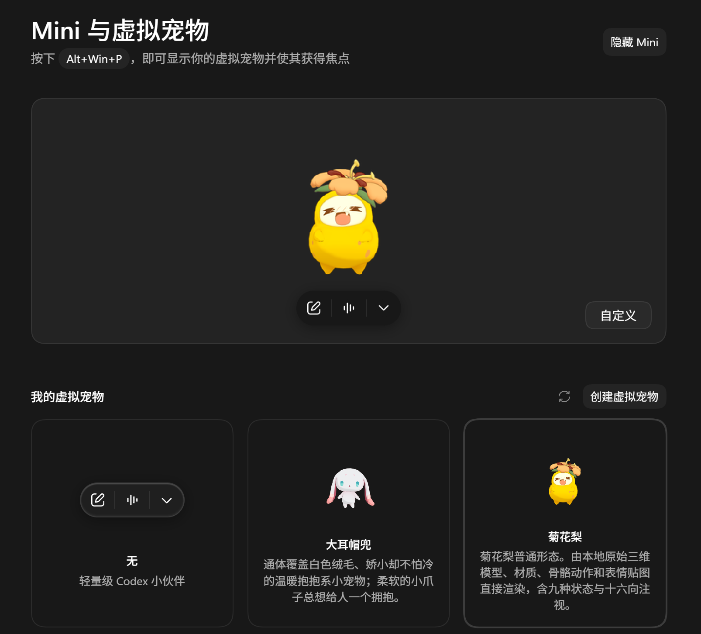
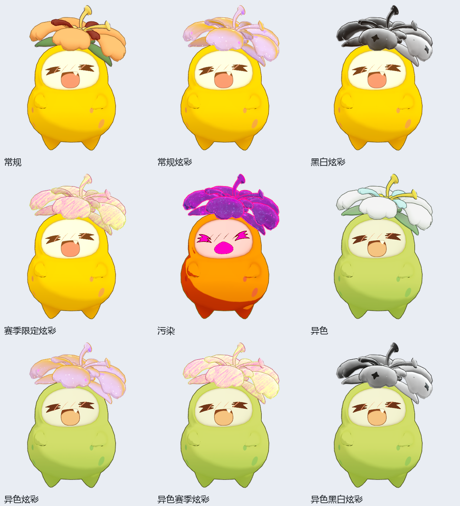

# rocom-codex-pets-gen

**把《洛克王国：世界》里的宠物放到 Codex 做桌宠。**

[](LICENSE)
[](https://www.python.org/)
[](SKILL.md)

从你提供的标准资源目录，直接渲染宠物的原始三维模型、材质、骨骼动作和表情，生成适用于 Pets 的动画精灵表，并按要求预览、安装、更新和打包。

**不带任何游戏素材。需要自行按照[资源目录规范](docs/resource-directory.md)准备资源目录，以便调用生成。** 本仓库不提供模型、贴图、动作、声音、宠物资源包或资源准备工具；文档中的图片仅用于展示效果。

[快速开始](#快速开始) · [Prompt 模板](#prompt-模板) · [资源目录规范](docs/resource-directory.md) · [颜色选择说明](references/color-appearance.md) · [许可与声明](#许可与声明)

## 效果示意



示意截图中的宠物由原模型渲染。界面与可用功能以你所使用的 Codex / Pets 版本为准。

## 能做什么

- **原模型直接渲染**：沿用模型、材质和动作，不调用图像生成模型重画角色或侧面。
- **动作与表情**：比较同类型的多个原动作，挑选合适片段；使用原眼口图集、表情曲线和眨眼。
- **九种颜色类型**：常规、常规炫彩、黑白炫彩、赛季限定炫彩、污染、异色、异色炫彩、异色赛季炫彩、异色黑白炫彩。
- **动态效果**：炫彩沿用原材质参数和共享纹理；骨骼时间与材质时间分别采样。
- **默认图鉴描述**：用户未指定描述时，按中文精灵原名读取 B 站 WIKI 收录的游戏介绍原文；手动指定的描述始终优先。
- **清晰度检查**：高分辨率原生渲染、透明边缘抗锯齿、统一构图与基线，检查最终小尺寸效果。
- **完整交付**：九种动画状态、十六向注视、预览、来源记录、校验结果及独立精灵表；可创建新宠物或替换已有宠物。

## 颜色与模型形态

“本来的样子”“看守麦田的样子”等**模型形态**，与普通、异色、炫彩等**颜色类型**分别确定。不同实体、不同模型形态，以及常规与异色基础材质，都要分别存放；不能把一整条进化链或两套基础配色放进同一输入目录。

同一份基础资源可以制作不同炫彩，但每种颜色结果分别输出。污染不能与异色叠加；黑白与异色黑白保留独立分类。



从左到右、从上到下依次为九类颜色。图中的赛季效果只展示一个示例；**可选赛季每次从当前资源清单读取，名称和数量均不写死**。常规炫彩的配色与粒子/纹样也以当前资源为准。

已明确的颜色选择会直接沿用；未指定或不明确时，skill 只询问缺少的项目。详见[颜色选择与动态预设](references/color-appearance.md)。

## 快速开始

### 1. 准备运行环境

- 能使用本地 skills 的 Codex 环境，以及已启用并连接的 **Pets 插件**。
- Python **3.11+**。
- 一份符合[资源目录规范](docs/resource-directory.md)的单实体目录。
- 用户自行提供的兼容离屏渲染器。当前适配器已验证 `rocom-pets 1.14.2` 的 PNG 接口；本仓库不分发渲染器。

### 2. 安装 skill

可以直接在 Codex 中让安装器从本仓库安装：

```text
$skill-installer 请从 https://github.com/ElliottZhao666666/rocom-codex-pets-gen 安装这个 skill。
```

也可以手动放入个人 skills 目录。Windows PowerShell 示例：

```powershell
$skillDir = Join-Path $HOME '.agents\skills\rocom-codex-pets-gen'
git clone https://github.com/ElliottZhao666666/rocom-codex-pets-gen.git $skillDir
python -m pip install -r (Join-Path $skillDir 'requirements.txt')
```

Codex 的目录发现与安装方式可参考 [OpenAI 官方 skills 文档](https://learn.chatgpt.com/docs/build-skills#where-codex-loads-local-skills)。安装后若尚未出现该 skill，重启 Codex 再试。

### 3. 提供目录并调用

复制下方模板，替换成自己的资源、渲染器和输出路径。无需把资源放进本仓库；输出目录也应位于资源目录之外。

## Prompt 模板

下面的路径仅为示例，使用前请替换。涉及颜色的模板会沿用你明确的选择；只有缺项才询问。未明确要求安装时，只生成和预览。

### 常规颜色：生成并导出

```text
使用 $rocom-codex-pets-gen 制作菊花梨桌宠。

资源目录：D:\PetResources\菊花梨-常规
渲染器：D:\Tools\rocom-pets.exe
输出目录：D:\PetOutputs\菊花梨-常规
颜色类型：常规。

直接使用原模型、材质、动作和表情，比较各类动作候选后再选择。
生成九种状态和十六向注视，检查边缘与清晰度。
完成后提供预览、独立精灵表和打包文件，本次不安装。
```

### 异色炫彩：先选择配色与纹样

```text
使用 $rocom-codex-pets-gen 制作菊花梨的异色炫彩桌宠。

资源目录：D:\PetResources\菊花梨-异色
渲染器：D:\Tools\rocom-pets.exe
输出目录：D:\PetOutputs\菊花梨-异色炫彩
颜色类型：异色炫彩。

先读取当前资源中的配色和粒子/纹样选项，让我选择缺少的两项。
选择确定后再渲染。保留异色基础材质、原始动作和表情，
并检查炫彩流动及缩小后的闪点表现。完成后预览并打包。
```

### 赛季炫彩：从当前资源动态选择

```text
使用 $rocom-codex-pets-gen 制作赛季限定炫彩桌宠。

资源目录：D:\PetResources\音速犬-看守麦田的样子-常规
渲染器：D:\Tools\rocom-pets.exe
输出目录：D:\PetOutputs\音速犬-看守麦田的样子-赛季炫彩
颜色类型：赛季限定炫彩。

模型形态使用这个目录已经选定的“看守麦田的样子”。
先读取当前资源清单，列出可用赛季让我选择，不使用固定的历史赛季列表。
确定后直接渲染原始内容，提供动画预览和独立文件。
```

### 异色黑白：替换已有桌宠并安装

```text
使用 $rocom-codex-pets-gen 更新我已有的“大耳帽兜”桌宠。

资源目录：D:\PetResources\大耳帽兜-异色
渲染器：D:\Tools\rocom-pets.exe
输出目录：D:\PetOutputs\大耳帽兜-异色黑白
颜色类型：异色黑白炫彩。

沿用当前资源中的黑白预设，不需要再询问常规炫彩配色和纹样。
使用原始模型、动作和表情重新渲染，校验并展示预览后，
替换原有桌宠并启用，保持原宠物的稳定 ID，不创建重复条目。
另外导出一份独立精灵表和压缩包。
```

如果你已经知道完整配色、纹样或赛季名称，直接写进 prompt 即可。仅需检查目录时，也可以要求“只校验资源并列出可用外观，不渲染、不安装”。

桌宠描述可选填：写明时按你的原文使用；未指定时，默认从 `https://wiki.biligame.com/nrc/<中文精灵原名>` 的图鉴介绍元素获取原文。读取失败或无法确认精灵身份时，会说明原因并询问，不自动编写替代描述。定位方式和后续描述传递规则见 [SKILL.md 的桌宠描述流程](SKILL.md#桌宠描述)。

也可单独运行描述获取脚本（使用 Python 标准库），把结果记录到仓库和素材目录之外：

```powershell
python scripts/get_pet_description.py --input 'D:\PetResources\菊花梨-常规' --json-out 'D:\PetOutputs\菊花梨-常规\description.json'
```

抓取仅读取介绍文字，并记录页面、选择器和时间；本仓库不收录实际图鉴介绍或网页副本。此来源是 B 站 WIKI 收录的游戏图鉴文本，WIKI 本身不是游戏官网。

## 资源目录与生成流程

完整字段、文件关系及人和 AI 均可阅读的虚构示例，已独立放在 **[资源目录规范](docs/resource-directory.md)**。其中所有示例参数均为随机构造，不能直接用于实际宠物。

基本流程是：**校验输入 → 确定形态、颜色与描述 → 比较动作和表情 → 原生渲染 → 预览及质量检查 → 按要求安装、更新与打包**。

需要手动检查时，可在仓库目录运行：

```powershell
python scripts/validate_input.py --input 'D:\PetResources\菊花梨-常规'
python scripts/color_appearance.py --input 'D:\PetResources\菊花梨-常规'
```

[渲染计划](references/render-plan.md)说明动作时间、材质时间和视角字段；[SKILL.md](SKILL.md)是 Codex 执行流程的入口。

## 已知边界

- 当前渲染适配器运行在 Windows，面向已验证的资源格式及兼容渲染器接口。
- Pets 采用预渲染精灵表。当前 v2 为 1536×2288，每格仍为 192×208；清晰度与流动连贯性受最终格子及帧数限制。
- 当前 Pets 接口只接收精灵表时，声音只能随私有包附带，不会自动联动播放。
- 新赛季或新 shader 需要相应资源和渲染器支持；缺失时会报告错误，不会换成另一种效果。

## 开发检查

```powershell
python -m unittest discover -s tests -v
python scripts/audit_repo.py
```

测试使用临时合成数据。素材、运行缓存和本地成品应保存在仓库之外；源码检查仅允许两张已登记的文档示意图。

## 许可与声明

本项目的程序和可授权文档采用 [MIT License](LICENSE)。

- 本项目为非官方工具，不代表《洛克王国：世界》或 OpenAI 官方。
- **不带任何游戏素材。需要自行按照资源目录规范准备资源目录，以便调用生成。** 不提供素材下载、获取或拆包工具。
- 游戏名称、角色形象、模型、美术、声音和商标等相关权利归各自权利人所有。两张文档图片仅作效果示意，不是可用于生成的资源包。
- MIT 许可证不授予上述第三方内容的权利，也不替代你使用相关资源时需要遵守的许可。

感谢 [rocom-pets](https://github.com/whoisnian/rocom-pets) 提供原模型桌宠渲染的参考实现与兼容接口；本仓库不包含其程序分发件。
